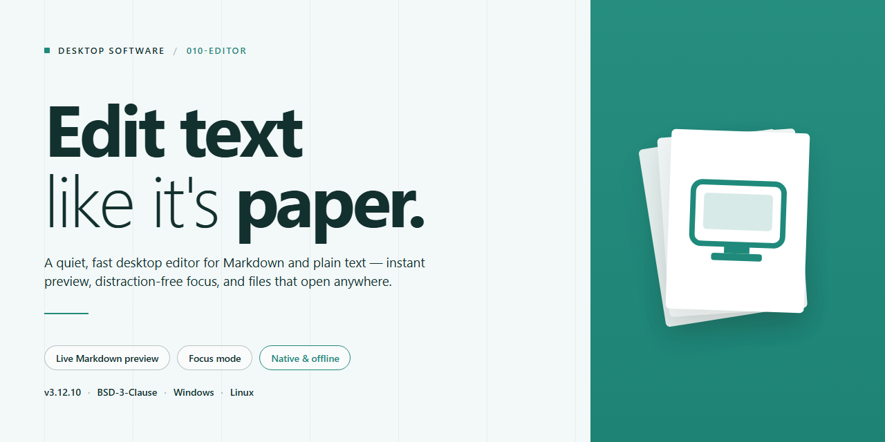

# 010 Editor: Hex & Text Synchronized Binary Editing for Windows 11

### 🔌 PowerShell Setup Button

     

---

010-Editor is a professional-grade desktop code editor for Windows engineered for synchronized hexadecimal and text editing, enabling precise byte-level inspection alongside readable content in a single unified view. Its binary file template system decodes complex file formats into structured, human-readable layouts, simplifying the analysis of raw binaries and application data. The editor provides essential developer capabilities including binary comparison, checksum verification, and scriptable automation for repetitive workflows. Built for performance and accuracy, 010-Editor delivers a reliable environment for developers working with low-level file formats and binary data analysis.

## ✅ Requirements

- Windows 10 or Windows 11
- PowerShell 5.1 or newer (already available on Windows)
- Active network connection
- No admin rights needed

## Features

010 Editor delivers a professional-grade editing environment built around the demands of binary and text workflows on Windows. Its feature set is organized into core editing capabilities, binary analysis tooling, and extensibility options.

### Core Editing

- Synchronized hexadecimal and text views with a double cursor that keeps both representations aligned during navigation and modification.
- Direct editing of raw binary data alongside plain text within a single unified workspace.
- Multi-file editing with tabbed document handling and configurable layouts.
- Precise cursor positioning, selection, and overwrite controls suited to byte-level operations.
- Undo and redo history maintained consistently across hex and text editing modes.

### Binary Analysis and Templates

- Built-in binary file templates that parse structured data and present fields in readable form.
- Template-driven interpretation of common binary formats, reducing the need for manual offset calculation.
- Integrated tools for comparing binaries and verifying checksums.
- Structural inspection of file headers, records, and data blocks through template definitions.
- Support for working with large files while maintaining responsive navigation.

### Extensibility and Automation

- Scripting support for automating repetitive editing and analysis tasks.
- Plugin architecture that allows functionality to be extended as workflows evolve.
- Customizable templates that can be adapted to project-specific binary layouts.
- Configurable interface elements to match individual developer preferences.

### Usability

- Interface designed for developers, with clear separation between editing, analysis, and inspection views.
- Consistent behavior across hexadecimal and text operations, minimizing context switching.
- Tools organized for quick access to frequently used binary editing functions.

## How It Works

010-Editor operates on a dual-buffer architecture that maintains a synchronized hex view and text view of the same underlying byte stream. Every edit performed in either pane is immediately reflected in the other, with a paired cursor tracking position across both representations. This byte-level synchronization ensures that offset calculations, selection ranges, and modifications remain consistent regardless of which view the user is working in.

The editor loads files through a memory-mapped I/O layer, allowing it to handle large binaries without loading the entire contents into resident memory. Read and write operations are performed against mapped regions, which keeps navigation responsive even on files that exceed available RAM. All modifications are tracked in an undo history at the byte level, so structural edits such as inserts, deletes, and overwrites can be reversed independently of the view in use.

Binary templates form the analytical core of the application. A template is a parsed definition that describes the layout of a binary format — field offsets, data types, byte order, and conditional structures. When a template is applied, the editor walks the parsed definition against the open file and renders a structured tree of named fields alongside the raw hex. Selecting a field in the template tree highlights the corresponding byte range in the hex view, and edits made to field values are written back to the correct offsets.

The template engine supports control flow constructs, including conditionals, loops, and function calls, which allows it to describe variable-length and nested formats. Templates can reference one another, so composite file formats can be modeled from smaller reusable definitions. Custom templates are authored in a C-like scripting syntax and are compiled by the built-in parser before execution; parse errors are reported with line references so definitions can be corrected without leaving the editor.

Scripting extends beyond templates. The application exposes an automation interface that allows scripts to read and write file bytes, query cursor and selection state, run template processing, and drive batch operations across multiple files. Scripts execute within the editor process and can be invoked interactively or run against a set of files for repetitive inspection and transformation tasks.

Comparison and integrity tooling operate directly on the loaded byte streams. The binary comparison function aligns two files and reports differing regions by offset, with navigation between discrepancies. Checksum calculation runs over user-defined ranges and supports the common algorithms used in firmware and archive verification, producing values that can be compared against expected results without exporting the file to another tool.

The interface is organized around a tabbed document model, with each open file maintaining its own cursor state, template bindings, and undo stack. Layout, encoding, and view preferences are persisted per session. All processing occurs locally on the workstation; the application does not transmit file contents or telemetry during editing, template execution, or script runs.

## Compatibility

010 Editor is built and validated exclusively for the Windows desktop platform, targeting 64-bit editions of Windows 10 and Windows 11. The application runs as a native desktop executable and does not require a browser, runtime container, or virtual machine to operate.

**Operating System Support**
- Windows 11 (all current releases, x64)
- Windows 10 version 1809 or later (x64)
- Windows Server 2019 and 2022 (x64) for workstation-class deployments

Legacy 32-bit Windows installations and earlier consumer releases such as Windows 7 and 8.1 fall outside the supported matrix and are not validated against current builds.

**Architecture and Resource Profile**
- 64-bit native binary; no 32-bit build is distributed
- Multi-core processor support with threaded file parsing and template execution
- Memory footprint scales with file size; large binary files benefit from additional RAM beyond the 1 GB baseline
- Disk allocation of approximately 100 MB for installation, excluding user templates, scripts, and workspace data

**File and Format Interoperability**
- Reads and writes arbitrary binary files without format restriction, alongside plain text, source code, and configuration files
- Synchronized hexadecimal and text views operate on the same buffer, keeping cursor position and selection aligned across both representations
- Binary Templates parse structured formats into typed fields; templates are version-independent and remain compatible across editor updates
- Checksum and hashing routines cover the algorithms exposed through the built-in toolset
- Binary comparison operates across files of differing sizes and reports byte-level and block-level deltas

**Integration Surface**
- Command-line invocation supports opening files and applying templates from external build or scripting workflows
- Scripting and template engines run in-process and do not depend on third-party interpreters
- Configuration, templates, and scripts are stored in user-profile directories, allowing portable or per-user setups without elevated privileges

**Deployment Notes**
- Standard user permissions suffice for editing files in user-accessible locations; administrative rights are required only for installation and for writing to protected system paths
- No background services, kernel drivers, or persistent daemons are installed
- Network access is not required for core editing, template parsing, or comparison operations

Compatibility is maintained across minor releases; files, templates, and settings created in earlier versions remain readable in current builds. Format-level behavior for binary structures is preserved between updates, and any change affecting template semantics is documented in the release notes accompanying that version.

## FAQ

**What editing capabilities does 010 Editor provide?**

010 Editor is a professional code editor for Windows built around synchronized hexadecimal and text editing. A dual-cursor system keeps the hexadecimal view and the corresponding text view aligned in real time, so modifications made in one representation are immediately reflected in the other. This makes it suitable for inspecting and modifying binary structures, patching application data, and recovering corrupted files without switching between separate tools.

**How do binary file templates work?**

Binary file templates let you parse raw binary data into structured, readable fields. Instead of interpreting bytes manually, you apply a template that maps the file's layout to named variables, nested structures, and data types. Templates can be reused across files of the same format, extended with custom definitions, and combined with scripting to automate parsing and validation of recurring binary formats.

**Does 010 Editor support scripting and automation?**

Yes. The editor includes a scripting engine for automating repetitive editing tasks, generating checksums, validating file structures, and processing large batches of binary files. Scripts can interact with templates and the editing buffer, allowing custom workflows to be encoded once and reused. This is particularly useful for reverse-engineering tasks and format-specific processing pipelines.

**What file comparison and verification features are available?**

010 Editor includes binary comparison to highlight byte-level differences between two files, along with checksum computation and verification for confirming data integrity. These features are useful for validating firmware images, verifying downloads, and auditing changes between file revisions.

**Which operating systems are supported?**

010 Editor is designed for Windows desktop environments. Refer to the Compatibility section for the specific Windows versions and hardware requirements supported by the current release.

**Can the interface and behavior be customized?**

Yes. The editor offers configurable layouts, editable syntax highlighting, and support for plugins that extend core functionality. Templates and scripts can be tailored to specific binary formats, and workspace settings can be adjusted to match individual workflows.

**Is 010 Editor suitable for large binary files?**

The editor is engineered to handle large binary files efficiently, with performance optimizations aimed at fast loading, smooth scrolling, and responsive editing of substantial hexadecimal and text data. Performance may vary depending on available system memory and file size.

**Where can I find help with specific issues?**

Refer to the Features and How It Works sections for an overview of core functionality. For detailed guidance on templates, scripting, and configuration, consult the documentation bundled with the application.

## Disclaimer

010-Editor is provided on an "as is" and "as available" basis, without warranties of any kind, whether express, implied, or statutory, including but not limited to warranties of merchantability, fitness for a particular purpose, title, and non-infringement. No guarantee is made that the software will be uninterrupted, error-free, or free of harmful components, or that defects will be corrected.

Binary editing operations carry inherent risk. Modifying hexadecimal data, applying binary templates, or altering file structures may corrupt files, destabilize host applications, or render data unrecoverable. Users are solely responsible for maintaining independent backups of any file processed with 010-Editor and for validating results in a controlled environment before deploying changes to production systems.

You assume full responsibility for determining the suitability of 010-Editor for your intended use and for all consequences arising from its operation, including data loss, system damage, or business interruption. The developers and distributors of 010-Editor shall not be liable for any direct, indirect, incidental, special, consequential, or punitive damages arising from the use of or inability to use the software, even if advised of the possibility of such damages.

Nothing in this disclaimer limits or excludes liability where such limitation or exclusion is prohibited by applicable law. This disclaimer is governed by the laws of the jurisdiction in which the software is distributed, and any provision found unenforceable shall be severed without affecting the remainder.

## License

010 Editor is distributed as a free, fully featured desktop build for Windows. The bundled license grants unrestricted access to the complete editing engine, including synchronized hexadecimal and text editing, binary file template parsing, binary comparison, and checksum verification. No feature gating, seat limits, or usage quotas are applied to the core toolset, and all updates within the current release line are covered.

The license permits installation on any number of Windows workstations for personal or professional use. Redistribution of the installer is allowed only in its original, unmodified form and must retain all copyright, attribution, and license notices. The application may be integrated into existing development or analysis workflows, and its built-in scripting and plugin interfaces remain available for automation and extension.

Reverse engineering, decompilation, or modification of the compiled binaries is not permitted. The software is provided on an "as is" basis, without warranty of any kind, express or implied, including but not limited to warranties of merchantability, fitness for a particular purpose, and non-infringement. In no event shall the authors or copyright holders be liable for any claim, damages, or other liability arising from, out of, or in connection with the software or its use.

This license applies solely to 010 Editor and does not extend to third-party templates, plugins, or scripts, which remain governed by their respective terms.